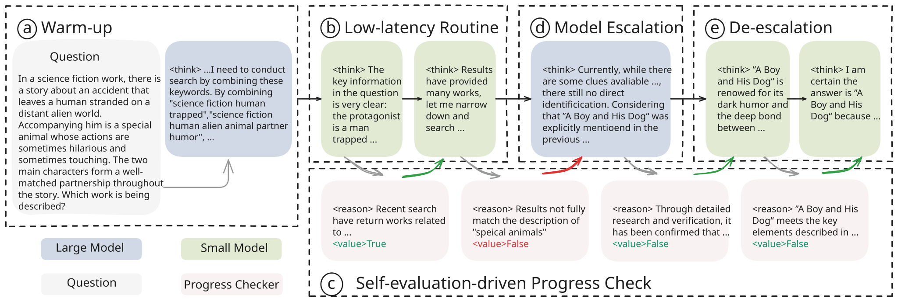
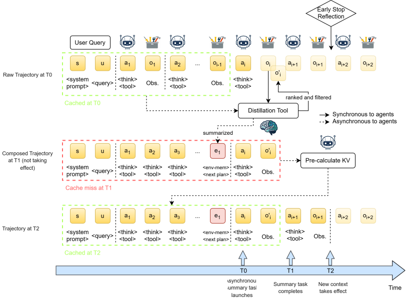

# AgentFlashInfer

<p align="center">
  
</p>

<p align="center">
  <strong>面向 Agentic AI 场景的高性能推理框架</strong>
</p>

<p align="center">
  <a href="./README.md">English</a>
</p>

<div align="center">
  <p>
    <a href="https://arxiv.org/abs/2512.18337"></a>
    <a href="https://arxiv.org/abs/2603.26034"></a>
    
    
  </p>
</div>

## 🔍 关于 AgentFlashInfer

AgentFlashInfer 是一个面向 Agent 推理场景的高性能推理框架，由两层能力构成：

- **Agent 特性层**：AgentCollab（大小模型协同）、Early Stop（早停）、Async Compression（异步压缩）等可插拔特性，通过配置开关独立控制，按需组合。
- **加速 Patch 层**：基于 monkey-patching 机制扩展 vLLM / vLLM-Ascend，提供投机解码、Agent 调度、PD 分离等加速能力。

### 已适配的 Agent 框架

| Agent 框架 | 模型系列 | 说明 |
| --- | --- | --- |
| **DeepDiver2 Agent** | [openPangu-Embedded-7B-DeepDiver](https://huggingface.co/openpangu/openPangu-Embedded-7B-DeepDiver) | 基于 Pangu 模型适配的 DeepDiver2 Agent。 |
| **Tongyi DeepResearch Agent** | Qwen | 基于 Qwen 系列模型适配的 Tongyi DeepResearch Agent。 |

**AgentFlashInfer 特性基准测试结果：**

<table align="center">
  <tr align="center">
    <th><p align="center"><strong>Async Compression</strong></p></th>
    <th><p align="center"><strong>AgentCollab</strong></p></th>
    <th><p align="center"><strong>Early Stop</strong></p></th>
  </tr>
  <tr>
    <td align="center"><p align="center">
      <table>
        <thead>
          <tr><th align="left">指标</th><th align="center">结果</th></tr>
        </thead>
        <tbody>
          <tr><td>延迟降低</td><td align="center">6% – 42%</td></tr>
          <tr><td>上下文缩减</td><td align="center">~40K → ~20K</td></tr>
        </tbody>
      </table>
    </p></td>
    <td align="center"><p align="center">
      <table>
        <thead>
          <tr><th align="left">指标</th><th align="center">结果</th></tr>
        </thead>
        <tbody>
          <tr><td>准确率</td><td align="center">97% 恢复率</td></tr>
          <tr><td>加速比</td><td align="center">~1.32×</td></tr>
        </tbody>
      </table>
    </p></td>
    <td align="center"><p align="center">
      <table>
        <thead>
          <tr><th align="left">指标</th><th align="center">结果</th></tr>
        </thead>
        <tbody>
          <tr><td>加速比</td><td align="center">~1.55×</td></tr>
          <tr><td>延迟降低</td><td align="center">35.3%</td></tr>
          <tr><td>标准差缩减</td><td align="center">237.87 → 84.51</td></tr>
        </tbody>
      </table>
    </p></td>
  </tr>
</table>

## ✨ 架构与功能概览

```
┌─────────────────────────────────────────────────────────┐
│                    Agent Application                     │
│            (DeepDiver V2 / DeepResearch / ...)           │
├─────────────────────────────────────────────────────────┤
│  Agent 特性层 (features/)                                │
│  ┌──────────┐ ┌───────────┐ ┌────────────┐             │
│  │  Model   │ │  Early    │ │Compression │             │
│  │ Routing  │ │   Stop    │ │ (Async)    │             │
│  └──────────┘ └───────────┘ └────────────┘             │
├─────────────────────────────────────────────────────────┤
│  加速 Patch 层 (inference/agentflashinfer/)             │
│  ┌──────────────────┐  ┌──────────────────────────────┐ │
│  │  Patch System    │  │  Accelerators                 │ │
│  │  @register ──►   │  │  ┌────────┐ ┌─────────────┐ │ │
│  │  vLLM / Ascend   │  │  │Agent   │ │Speculative  │ │ │
│  │  monkey-patch    │  │  │Sched.  │ │Decoding     │ │ │
│  └──────────────────┘  │  └────────┘ └─────────────┘ │ │
│                        └──────────────────────────────┘ │
├─────────────────────────────────────────────────────────┤
│  推理引擎 (vLLM / vLLM-Ascend)                          │
│  ┌────────────────────────────────────────────────────┐ │
│  │  Paged Attention  │  Continuous Batching  │  ...   │ │
│  └────────────────────────────────────────────────────┘ │
└─────────────────────────────────────────────────────────┘
```

**Agent 特性：**

| 特性 | 描述 | 配置开关 |
|------|------|----------|
| **AgentCollab** | 自评估驱动协同：小模型先处理任务，通过 progress check 判断是否升级到大模型 | `MODEL_ROUTING_SWITCH` |
| **Early Stop** | 检测停滞迭代并注入完成引导 | `early_stop_enabled` |
| **Async Compression** | 异步压缩长对话历史，控制 token 数增长 | `resum_compress_async` |

**加速 Patch（纯文字）：**

| Patch | 描述 | 配置开关 |
|-------|------|----------|
| **Agent Scheduler** | KV-cache 感知调度，SJF/Peak Split/Prefill Delay 策略 | `agent_scheduler` |
| **Speculative Decoding** | SAM/Suffix/Ngram 匹配，通过 draft token 加速 | `speculative_decoding` |
| **Disaggregate Prefill** | Prefill/Decode 分离，跨节点协同推理 | `disaggregate_prefill_enabled` |

---

## 🎯 Agent 特性详解

### 1. AgentCollab（大小模型协同）

自评估驱动协同范式：小模型先处理任务，通过 self-driven evaluation 进行 progress check，判断是否升级到大模型。

<p align="center">
  
</p>

**工作流程：**
1. **小模型处理**：小模型处理任务
2. **自评估检查**：通过 self-driven evaluation 进行 progress check
3. **进展判断**：判断结果是否满足要求
4. **模型升级**：若 progress check 失败则升级到大模型

**配置项：**

| 配置项 | 说明 | 默认值 |
|--------|------|--------|
| `MODEL_ROUTING_SWITCH` | 是否启用模型路由 | `true` |
| `SMALL_MODEL_URL` | 小模型 OpenAI 兼容端点 | - |
| `LARGE_MODEL_URL` | 大模型 OpenAI 兼容端点 | - |
| `SMALL_MODEL_NAME` | 小模型服务名 | - |
| `LARGE_MODEL_NAME` | 大模型服务名 | - |

> 详细文档：[agentic/docs/model_routing.md](agentic/docs/model_routing.md)

---

### 2. Early Stop（早停）

检测 Agent 循环中的停滞迭代，并向下一轮注入完成引导。这是引导注入，不是硬终止。

<p align="center">
  
</p>

**检测策略：**
- **重复输出**：检测重复思考
- **最小轮次**：达到配置轮次后开始检查
- **自动注入**：向下一轮加入完成引导

**配置项：**

| 配置项 | 说明 | 默认值 |
|--------|------|--------|
| `early_stop_enabled` | 是否启用早停 | `true` |
| `early_stop_min_iter` | 检测前最小迭代次数 | `2` |

> 详细文档：[agentic/docs/early_stop.md](agentic/docs/early_stop.md)

---

### 3. Async Compression（异步压缩）

异步压缩长对话历史，控制 token 数增长，避免超出上下文窗口限制。

**压缩流程：**
1. **阈值检测**：token 超过阈值时触发
2. **后台压缩**：异步提交压缩任务
3. **语义保留**：保留关键语义信息
4. **恢复**：使用压缩后上下文继续对话

**配置项：**

| 配置项 | 说明 | 默认值 |
|--------|------|--------|
| `resum_compress_async` | 是否启用异步压缩 | `true` |
| `TOKEN_THRESHOLD` | 触发压缩的 token 阈值 | `10` |
| `SEARCH_COMPRESS_URL` | 压缩模型端点 | `OPENAI_BASE_URL/chat/completions` |
| `SEARCH_COMPRESS_MODEL_NAME` | 压缩模型名 | `EXAMPLE_MODEL_NAME` |

> 详细文档：[agentic/docs/multi_round_compression.md](agentic/docs/multi_round_compression.md)

---

## ⚡ 加速 Patch 详解

### 4. Agent Scheduler（Agent 调度器）

针对 Agentic AI 场景的 KV-cache 感知调度优化，包含三个子方案：

| 子方案 | 说明 |
|--------|------|
| **SJF (Short Job First)** | 优先处理短作业，避免长序列阻塞吞吐 |
| **Peak Split** | 请求少时关闭 chunked prefill，加速 decode 切换 |
| **Prefill Delay** | 运行请求充足时延迟 prefill，批量处理提升效率 |

**调度策略：**

| 策略 | 说明 |
|------|------|
| `fcfs` | 先来先服务（默认） |
| `sjf` | 短作业优先 |
| `priority` | 优先级调度 |
| `agent` | KV-cache 感知调度，首次 KV 驱逐后按缓存命中率排序 |

> 详细文档：[agentic/inference/docs/feature/agent_sched.md](agentic/inference/docs/feature/agent_sched.md)

---

### 5. Disaggregate Prefill（分离预填充）

Prefill/Decode 分离部署，支持跨节点 Prefill 与 Decode 协同推理，适用于大规模服务场景。

**配置项：**

| 配置项 | 说明 | 默认值 |
|--------|------|--------|
| `enabled` | 是否启用 PD 分离 | `false` |
| `prefill_nodes` | Prefill 节点列表 | - |
| `decode_nodes` | Decode 节点列表 | - |

> 详细文档：[agentic/inference/docs/feature/disaggregate_prefill.md](agentic/inference/docs/feature/disaggregate_prefill.md)

---

### 6. Speculative Decoding（投机解码）

支持多种投机解码方案，利用 draft token 加速推理：

| 方法 | 说明 | 依赖 |
|------|------|------|
| `sam` | 后缀自动机匹配，适合重复模式多的 Agent 场景 | 内置 / `samfast`(可选) |
| `suffix` | 后缀树匹配 | `arctic_inference` |
| `ngram` | N-gram 统计匹配 | 内置 |

**自适应开关**：`batch_size_auto_switch` 在并发请求数超过阈值时自动禁用投机解码，避免高负载下的吞吐损失。

> 详细文档：[agentic/inference/docs/feature/speculative_decoding.md](agentic/inference/docs/feature/speculative_decoding.md)

---

## 🚀 快速开始

### 1. 克隆并进入仓库

```bash
git clone git@github.com:SparkEngineAI/AgentFlashInfer.git
cd AgentFlashInfer
```

### 2. 下载模型

```bash
git lfs install
mkdir -p weights
git clone https://huggingface.co/openpangu/openPangu-Embedded-7B-DeepDiver \
  weights/openPangu-Embedded-7B-DeepDiver
```

### 3. 创建环境

```bash
conda create -n agentflashinfer python=3.10 -y
conda activate agentflashinfer
cd /path/to/AgentFlashInfer/agentic
python -m pip install -r requirements.txt
python -m pip install -e . --no-deps


用于启动服务的 vLLM 运行环境已验证版本为 `vllm==0.18.1`。
```

### 4. 配置 DDv2

```bash
cd /path/to/AgentFlashInfer/agentic
cp .env.example .env
```

在 `.env` 中填写：
```dotenv
MODEL_ROUTING_SWITCH=true
SMALL_MODEL_URL=http://127.0.0.1:8103/v1
SMALL_MODEL_NAME=pangu_small
LARGE_MODEL_URL=http://127.0.0.1:8104/v1
LARGE_MODEL_NAME=pangu_large
SMALL_MODEL_API_KEY=EMPTY
LARGE_MODEL_API_KEY=EMPTY
SEARCH_URL=<搜索服务地址>
SEARCH_API_KEY=<搜索服务密钥>
URL_CRAWLER_API_KEYS=<网页读取密钥>
PROXY_CACHE=
```

关闭路由时，可将 small endpoint 作为默认模型：

```dotenv
MODEL_ROUTING_SWITCH=false
OPENAI_BASE_URL=http://127.0.0.1:8103/v1
EXAMPLE_MODEL_NAME=pangu_small
OPENAI_API_KEY=EMPTY
```

### 5. 启动两个 Pangu vLLM 实例

在两个独立终端分别运行：

```bash
MODEL_PATH=/Path/to/Pangu_Small
CUDA_VISIBLE_DEVICES=0 VLLM_USE_V1=1 VLLM_WORKER_MULTIPROC_METHOD=spawn vllm serve "$MODEL_PATH" --served-model-name pangu_small --host 127.0.0.1 --port 8103 --tensor-parallel-size 1 --trust-remote-code --tokenizer-mode slow --dtype bfloat16 --gpu-memory-utilization 0.90 --disable-uvicorn-access-log
```

```bash
MODEL_PATH=/Path/to/Pangu_Large
CUDA_VISIBLE_DEVICES=1 VLLM_USE_V1=1 VLLM_WORKER_MULTIPROC_METHOD=spawn vllm serve "$MODEL_PATH" --served-model-name pangu_large --host 127.0.0.1 --port 8104 --tensor-parallel-size 1 --trust-remote-code --tokenizer-mode slow --dtype bfloat16 --gpu-memory-utilization 0.90 --disable-uvicorn-access-log
```

健康检查：

```bash
curl --noproxy "*" -fsS http://127.0.0.1:8103/v1/models
curl --noproxy "*" -fsS http://127.0.0.1:8104/v1/models
```
### 6. 快速使用 `run_ddv2.sh`

保持 vLLM 在独立终端运行，然后让脚本自动启动 MCP 和 DDv2 Agent Server，并在终端输入 Query：

```bash
cd /path/to/AgentFlashInfer/agentic
conda run --no-capture-output -n agentflashinfer \
  env PYTHONNOUSERSITE=1 bash run_ddv2.sh --interactive
```

也可以通过命令行参数或环境变量直接传入 Query：

```bash
bash run_ddv2.sh --query "研究 Agent 推理的最新进展。"
DDV2_QUERY="研究 Agent 推理的最新进展。" bash run_ddv2.sh
```

vLLM 服务需要提前启动。脚本会等待 `/history` 返回 completed 结果，将最终答案打印到终端，运行日志保存到 `agentic/ci_logs/`，随后只清理本次启动的 MCP 和 Agent Server 进程。

> 补充：如使用 Tongyi DeepResearch，请为 Qwen 配置 `agentic/.env` 并启动其 vLLM 服务，再执行 `bash run_tongyi.sh --interactive` 或 `bash run_tongyi.sh --query "你的问题"`。

### 7. 手工启动 MCP 和 Agent（可选）

```bash
# 终端 1
cd /path/to/AgentFlashInfer/agentic
PYTHONNOUSERSITE=1 PYTHONPATH="$PWD" DISABLE_DISTRIBUTED_STORAGE=true \
  conda run -n agentflashinfer \
  python agent_infer/mcp_factory/mcp_server.py

# 终端 2
cd /path/to/AgentFlashInfer/agentic
PYTHONNOUSERSITE=1 PYTHONPATH="$PWD" DISABLE_DISTRIBUTED_STORAGE=true \
  AGENT_PORT=8289 conda run -n agentflashinfer \
  python examples/deepdiver_v2/server/app_ddv2.py
```

### 8. 启动和使用 Web UI

UI 需要 vLLM、MCP 和 Agent 服务保持运行。

```bash
cd /path/to/AgentFlashInfer/agentic/agent_infer/ui/ui
npm ci --no-audit --no-fund
PORT=8001 npm run dev
```

1. 输入问题并点击 `SUBMIT`。
2. `CONCURRENCY CONFIG` 设置同一问题并行运行的 trace 数；建议先用 `×1`，需要并行探索时再用 `×4`。
3. 点击任务卡左侧的 `▶` 展开详情；运行结束后，在“📋 任务最终执行总结”中查看各线程的完整最终答案。

### 9. 使用 API 提交请求

```bash
curl --noproxy '*' -fsS http://127.0.0.1:8289/api/submit \
  -H 'Content-Type: application/json' \
  -d '{
    "user_input": "请使用网络搜索研究目标问题。",
    "agent_name": "assistant",
    "stream": false,
    "user_token": "demo",
    "concurrency": 1
  }'
```

运行日志位于 `agentic/ci_logs/`。如果大小模型 URL 指向同一端点，脚本验证的是路由逻辑，不是不同权重间的切换。Early Stop 是引导注入，不是硬终止。

---

## 📚 详细文档索引

### Agent 特性文档

| 文档 | 路径 |
|------|------|
| AgentCollab（大小模型协同） | [agentic/docs/model_routing.md](agentic/docs/model_routing.md) |
| Early Stop（早停） | [agentic/docs/early_stop.md](agentic/docs/early_stop.md) |
| Async Compression（异步压缩） | [agentic/docs/multi_round_compression.md](agentic/docs/multi_round_compression.md) |

### 加速 Patch 文档

| 文档 | 路径 |
|------|------|
| Patch 系统 | [agentic/inference/pangu_infer/patches/](agentic/inference/pangu_infer/patches/) |
| Speculative Decoding | [agentic/inference/docs/feature/speculative_decoding.md](agentic/inference/docs/feature/speculative_decoding.md) |
| Agent Scheduler | [agentic/inference/docs/feature/agent_sched.md](agentic/inference/docs/feature/agent_sched.md) |
| Disaggregate Prefill | [agentic/inference/docs/feature/disaggregate_prefill.md](agentic/inference/docs/feature/disaggregate_prefill.md) |

### 开发文档

| 文档 | 路径 |
|------|------|
| 安装指南 | [agentic/inference/docs/install.md](agentic/inference/docs/install.md) |
| 开发者指南 | [agentic/inference/docs/developer_guide.md](agentic/inference/docs/developer_guide.md) |
| 代码风格 | [agentic/inference/docs/code_style_guide.md](agentic/inference/docs/code_style_guide.md) |
| 开发规范 | [agentic/inference/docs/development_rules.md](agentic/inference/docs/development_rules.md) |

---

## 许可证

Copyright (c) 2026 Huawei Technologies Co., Ltd.

本项目采用 [Apache License 2.0](LICENSE)。第三方代码保留其原有许可证和版权声明。

## 📖 引用

如果您在研究中使用 AgentFlashInfer，请引用：

```bibtex
@article{lin2025towards,
  title={Towards Efficient Agents: A Co-Design of Inference Architecture and System},
  author={Lin, Weizhe and Zhen, Hui-Ling and Yang, Shuai and Wang, Xian and Liu, Renxi and Chen, Hanting and Zhang, Wangze and Zhou, Chuansai and Li, Yiming and Chen, Chen and others},
  journal={arXiv preprint arXiv:2512.18337},
  year={2025}
}

@article{gao2026agentcollab,
  title={AgentCollab: A Self-Evaluation-Driven Collaboration Paradigm for Efficient LLM Agents},
  author={Gao, Wenbo and Liu, Renxi and Wang, Xian and Guo, Fang and Yang, Shuai and Chen, Xi and Zhen, Hui-Ling and Chen, Hanting and Lin, Weizhe and Li, Xiaosong and others},
  journal={arXiv preprint arXiv:2603.26034},
  year={2026}
}
```
