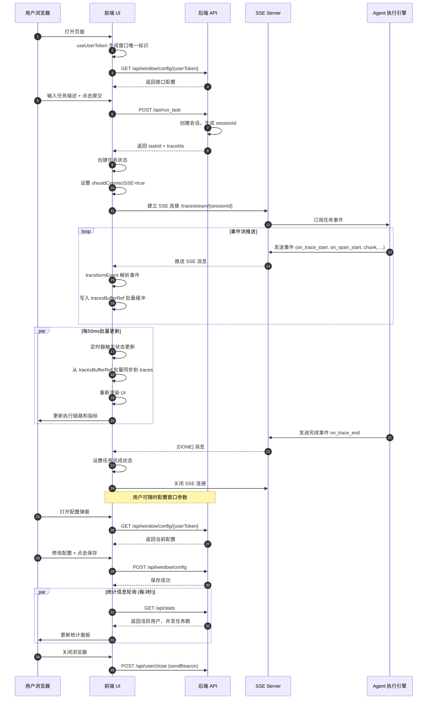

# Multi-Agent Trace Visualization UI

一个用于可视化和监控多智能体系统执行流程的 Web UI，通过 SSE（Server-Sent Events）实时接收并展示 Agent 运行过程中的各种事件、指标和执行链路。

## 目录

- [功能概述](#功能概述)
- [快速开始](#快速开始)
- [系统架构](#系统架构)
- [模块说明](#模块说明)
- [API 接口](#api-接口)
- [技术栈](#技术栈)

---

## 功能概述

### 核心功能

| 功能 | 说明 |
|------|------|
| **实时任务执行监控** | 通过 SSE 流式接收 Agent 的执行事件，实时展示任务进度 |
| **执行链路可视化** | 以时间线形式展示 Agent 的执行过程，包括工具调用、生成结果等 |
| **性能指标监控** | 实时展示 LLM 调用的 TTFT、TPOT、ITL 等性能指标 |
| **多任务并发管理** | 支持同时监控多个 Agent 任务的执行状态 |
| **MCP 服务器负载监控** | 监控多个 MCP 服务器的调用次数和负载情况 |
| **端到端延迟统计** | 统计从任务开始到结束的总延迟 |
| **Agent Token 消耗统计** | 按 Agent 分组展示输入 Token 的消耗情况 |
| **窗口配置管理** | 按用户窗口保存配置，支持多窗口独立配置 |

### 使用场景

- **开发调试**：开发多智能体系统时，可视化查看 Agent 的执行链路
- **生产监控**：监控生产环境中 Agent 的实时运行状态
- **性能分析**：分析 Agent 调用 LLM 的性能指标，优化系统性能
- **问题诊断**：调试 Agent 的工具调用和生成结果
- **效果对比**：对比不同配置下 Agent 的执行效果

---

## 快速开始

### 环境要求

- Node.js >= 16
- npm 或 yarn

### 安装依赖

```bash
npm install
```

### 启动开发服务器

```bash
npm run dev
```

访问地址：`http://localhost:8000`

### 构建生产版本

```bash
npm run build
```

构建产物输出到 `dist` 目录。

### 预览生产版本

```bash
npm run serve
```

### 后端依赖

确保以下后端服务正常运行：

| 服务 | 说明 | 开发环境地址 |
|------|------|-------------|
| SSE 服务 | 实时事件流推送 | `http://localhost:8289` |
| 统计 API | 实时统计数据 | `/api/stats` |
| 配置 API | 窗口配置管理 | `/api/window/config` |

---

## 系统架构

### 时序图



### 数据流架构

```
┌─────────────────────────────────────────────────────────────────┐
│                        用户操作层                                 │
│  任务输入 │ 配置修改 │ 视图切换 │ 主题切换                         │
└─────────────────────┬───────────────────────────────────────────┘
                      │
                      ▼
┌─────────────────────────────────────────────────────────────────┐
│                        前端 UI 层                                │
│  ┌──────────────┐  ┌──────────────┐  ┌──────────────┐          │
│  │platformPage  │  │SessionContainer│ │traceVisualization│      │
│  └──────────────┘  └──────────────┘  └──────────────┘          │
│  ┌──────────────┐  ┌──────────────┐                           │
│  │ MetricsPanel │  │ ConfigModal  │                           │
│  └──────────────┘  └──────────────┘                           │
└─────────────────────┬───────────────────────────────────────────┘
                      │
                      ▼
┌─────────────────────────────────────────────────────────────────┐
│                        状态管理层                                 │
│  ┌─────────────────────────────────────────────┐               │
│  │  globalContext (全局状态: 主题)              │               │
│  └─────────────────────────────────────────────┘               │
│  ┌─────────────────────────────────────────────┐               │
│  │  useState (任务列表、配置、用户输入)          │               │
│  └─────────────────────────────────────────────┘               │
│  ┌─────────────────────────────────────────────┐               │
│  │  tracesBufferRef (SSE 事件批量缓冲)          │               │
│  └─────────────────────────────────────────────┘               │
└─────────────────────┬───────────────────────────────────────────┘
                      │
                      ▼
┌─────────────────────────────────────────────────────────────────┐
│                        自定义 Hooks                               │
│  ┌─────────────────────────────────────────────┐               │
│  │  useSSEStreamByTrace (SSE 连接、事件解析)   │               │
│  └─────────────────────────────────────────────┘               │
│  ┌─────────────────────────────────────────────┐               │
│  │  useUserToken (窗口唯一标识管理)             │               │
│  └─────────────────────────────────────────────┘               │
│  ┌─────────────────────────────────────────────┐               │
│  │  useMutableState (可变状态容器)              │               │
│  └─────────────────────────────────────────────┘               │
└─────────────────────┬───────────────────────────────────────────┘
                      │
                      ▼
┌─────────────────────────────────────────────────────────────────┐
│                        API 调用层                                 │
│  ┌──────────────┐  ┌──────────────┐  ┌──────────────┐          │
│  │/api/run_task│  │/api/stats    │  │/api/window/  │          │
│  └──────────────┘  └──────────────┘  │  config     │          │
│  ┌──────────────┐                      └──────────────┘          │
│  │SSE Connection│                                                │
│  │/tracestream/ │                                                │
│  └──────────────┘                                                │
└─────────────────────┬───────────────────────────────────────────┘
                      │
                      ▼
┌─────────────────────────────────────────────────────────────────┐
│                      后端服务层                                   │
│  Agent 执行引擎 │ SSE 服务器 │ 配置服务 │ 统计服务                │
└─────────────────────────────────────────────────────────────────┘
```

---

## 模块说明

### 目录结构

```
src/
├── components/          # React 组件
│   ├── traceVisualization.js   # 执行链路可视化组件
│   ├── sessionContainer.jsx    # 会话容器组件
│   ├── metricsStreamingPanel.jsx  # 性能指标面板
│   ├── durationTable.jsx       # 时延统计表格
│   ├── ConfigModal.jsx         # 配置弹窗
│   └── scrollableContent.jsx   # 可滚动内容容器
├── hook/               # React Hooks
│   ├── useSSEStreamByTrace.js  # SSE 流式数据接收 Hook
│   ├── useUserToken.js         # 用户 token 管理 Hook
│   └── useMutableState.js      # 可变状态管理 Hook
├── context/            # React Context
│   └── globalContext.js        # 全局状态 Context
├── utils/              # 工具函数
│   ├── formatUtil.js           # 格式化工具
└── pages/              # 页面组件
    ├── index.js                # 首页入口
    └── platformPage.js         # 主平台页面
```

### 组件模块

#### 1. traceVisualization.js - 执行链路可视化

**作用**：将 Agent 的执行事件树形结构可视化展示

**核心功能**：
- 解析和构建 Agent、工具、Generation 事件树
- 支持展开/收起节点查看详细信息
- 支持压缩模式，简化复杂链路展示
- 显示事件的持续时间、调用关系

**实现原理**：
```
事件流 -> spanMap 构建树结构 -> 遍历渲染 -> AgentCard/ToolCard/GenerationCard
```

**支持的节点类型**：
- `agent` - Agent 节点
- `function` - 工具调用节点
- `generation` - LLM 生成节点
- `mcp_tools` - MCP 工具节点
- `custom` - 自定义节点（如 llm_call_metric）

#### 2. sessionContainer.jsx - 会话容器

**作用**：封装单个任务会话的展示逻辑

**核心功能**：
- 管理 SSE 连接状态
- 提供时间线/瀑布流两种视图模式
- 集成指标面板和可视化组件
- 支持最大化/最小化切换

**状态管理**：
```
SSE 事件 → tracesBufferRef (批量缓冲 50ms) → traces State → UI 渲染
```

#### 3. metricsStreamingPanel.jsx - 性能指标面板

**作用**：实时展示 LLM 调用性能指标

**核心功能**：
- **TTFT**（Time To First Token）首字延迟统计：最小值、平均值、最大值
- **TPOT**（Time Per Output Token）每令牌延迟统计
- **P99 ITL**（Per-Input Token Latency）99分位延迟统计
- **E2E Latency**（End-to-End）端到端延迟统计
- **MCP Load** - 多个 MCP 服务器的实时负载调用次数
- **Input Tokens by Agent** - 各 Agent 的 Token 消耗趋势

#### 4. ConfigModal.jsx - 配置弹窗

**作用**：提供配置管理界面，支持三类配置分组

**配置分类**：

| 分类 | 说明 |
|------|------|
| **工具优化** | MCP Hub 负载均衡、工具预测等 |
| **推理优化** | AgentInfer 加速、模型路由等 |
| **参数配置** | 模型参数、最大轮次、记忆功能等 |

**核心逻辑**：
- 开启 `agent_infer_switch` 时，自动启用子开关（压缩、早停、路由）
- 条件显示：使用 `showWhen` 控制配置项的显示条件
- 按 `userToken` 保存/加载配置，支持多窗口独立配置

### Hooks 模块

#### 1. useSSEStreamByTrace.js - SSE 流式数据接收

**作用**：管理 SSE 连接，实时接收并处理事件流

**核心功能**：
- 建立/断开 SSE 连接
- 解析 SSE 消息并转换为事件对象
- 使用 `tracesBufferRef` 批量更新状态，减少渲染次数
- 支持 Mock 数据模式用于开发调试

**事件处理流程**：
```
EventSource.onmessage
    ↓
transformEvent 解析
    ↓
按事件类型分发到 tracesBufferRef
    ↓
50ms 定时器批量同步到 traces State
```

**支持的事件类型**：

| 事件类型 | 说明 |
|---------|------|
| `trace.span.chunk` | Token 流式输出 |
| `on_trace_start` | 任务开始 |
| `on_trace_end` | 任务结束 |
| `on_span_start` | 节点开始 |
| `on_span_end` | 节点结束 |
| `on_status_update` | 状态更新（包含性能指标） |

#### 2. useUserToken.js - 用户 Token 管理

**作用**：为每个浏览器窗口生成唯一标识

**核心原理**：
- 基于 `window.name` 生成唯一窗口 ID（格式：`win_{timestamp}_{random}`）
- 使用 `sessionStorage` 存储 token（key: `userToken_{windowId}`）
- 每个浏览器窗口有独立的 token，用于窗口级别的配置隔离

#### 3. useMutableState.js - 可变状态管理

**作用**：提供非响应式的状态存储

**核心特性**：
- 类似 mini-store 的状态容器
- 修改不会触发 React 重渲染
- 初始化只执行一次

**提供的方法**：
- `get(key)` - 获取值
- `set(key, value)` - 设置值
- `setAll(obj)` - 批量设置
- `delete(key)` - 删除值
- `has(key)` - 检查是否存在
- `update(key, updater)` - 基于旧值更新
- `getAll()` - 获取完整数据

### Context 模块

#### globalContext.js - 全局状态管理

**作用**：提供全局状态和切换功能

**核心功能**：
- 管理 `isBlank` 状态，控制暗色/亮色主题
- 提供 `useGlobal` 自定义 Hook 给组件使用
- 封装 `setIsBlank` 方法供主题切换使用

### Utils 模块

#### formatUtil.js - 格式化工具

**提供的方法**：
- `formatString(str)` - 解析字符串中的转义序列（`\n`, `\"` 等）
- `parseIfJson(str)` - 判断并格式化 JSON 字符串

### Pages 模块

#### index.js - 首页入口

**作用**：应用根组件

**功能**：
- 初始化 `userToken`
- 监听页面关闭事件，调用清理接口
- 包裹 `GlobalProvider` 提供全局状态
- 渲染 `MultiAgentPlatform`

#### platformPage.js - 主平台页面

**作用**：核心业务逻辑页面

**状态管理**：
- `tasks` - 任务列表
- `userInput` - 用户输入
- `concurrencyConfig` - 并发配置
- `realTimeStats` - 实时统计数据（每3秒轮询）
- `windowConfig` - 窗口配置
- `isBlank` - 主题状态

**核心逻辑**：
- 任务提交：POST `/api/run_task`
- 统计轮询：GET `/api/stats`
- 配置管理：GET/POST `/api/window/config`

---

## API 接口

| 接口 | 方法 | 说明 |
|------|------|------|
| `/api/run_task` | POST | 提交并执行任务 |
| `/api/stats` | GET | 获取实时统计信息 |
| `/api/tracestream/{sessionId}` | GET (SSE) | 流式获取任务事件 |
| `/api/window/config/{userToken}` | GET | 获取窗口配置 |
| `/api/window/config` | POST | 保存窗口配置 |
| `/api/user/close` | POST | 用户关闭窗口时的清理 |

### 状态更新事件格式 (on_status_update)

```json
{
  "event": "on_status_update",
  "data": [
    {
      "metrics": "agent_llm",
      "agent": "PlannerAgent",
      "tool": "main",
      "_call_latency": [3.261, 7.841, 6.646]
    }
  ]
}
```

### LLM 调用指标事件格式 (custom - llm_call_metric)

```json
{
  "event": "on_span_end",
  "span_type": "custom",
  "data": {
    "name": "llm_call_metric",
    "model": "pangu_auto",
    "metrics": {
      "ttft_ms": 205.51,
      "tpot_ms": 21.28,
      "p99_itl_ms": 106.34,
      "token_count": 302,
      "itls_ms": [0.39, 24.43, 26.08, ...]
    }
  }
}
```

---

## 技术栈

| 技术 | 版本 | 说明 |
|------|------|------|
| React | 19.2.0 | UI 框架 |
| Umi | 4.5.3 | React 应用框架 |
| Ant Design | 5.28.1 | UI 组件库 |
| Lucide React | 0.553.0 | 图标库 |
| Recharts | 3.5.1 | 图表库 |
| Axios | 1.13.2 | HTTP 请求库 |
| React Markdown | 10.1.0 | Markdown 渲染 |

---

## 开发说明

### 添加新事件类型
在 `useSSEStreamByTrace.js` 的 `transformEvent` 函数中添加新事件类型的解析逻辑。

### 添加新指标
在 `metricsStreamingPanel.jsx` 中添加指标的计算逻辑和图表组件。

## 许可证

ISC
